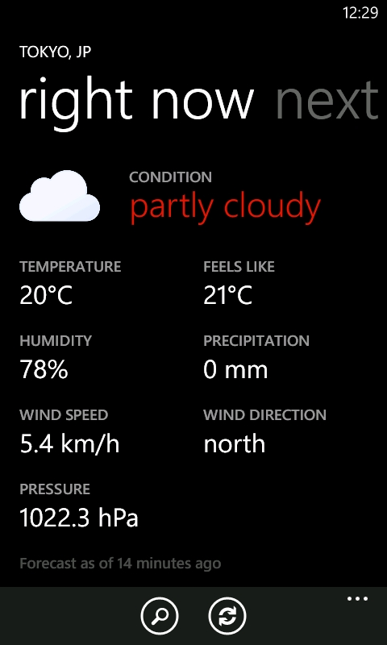
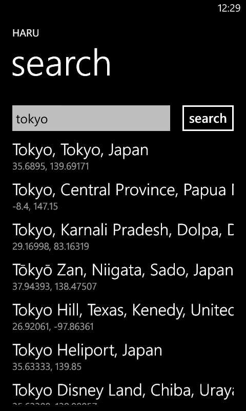
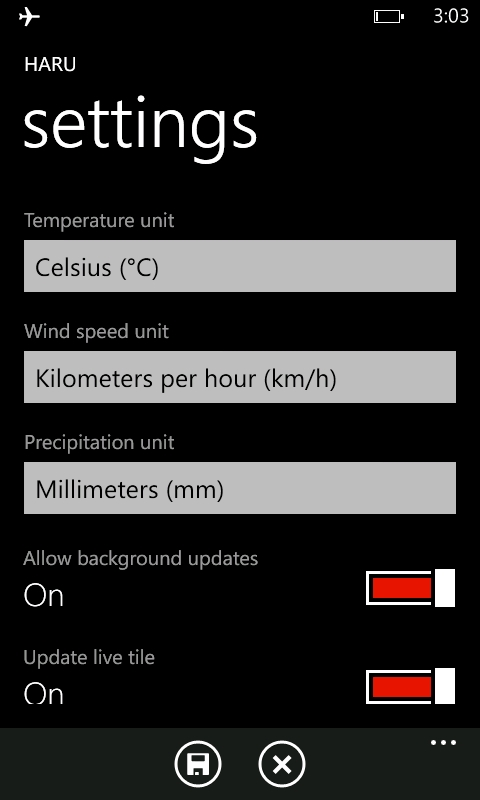
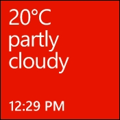

# Haru

A clean, modern weather application for Windows Phone that brings beautiful weather forecasts to your device.


## Features

### Home
- Shows the latest weather conditions
- Hourly forecasts for 12 hours
- Daily forecasts for 7 days
- Beautiful weather icons and easy-to-read layout

### Search
- Search locations worldwide
- Detailed location information
- **[NEW]** Use current location using GPS <sup>[[1]](#limitations-1)</sup><sup>[[2]](#limitations-2)</sup>

### **[NEW]** Favorites
- Add up to 6 favorite locations via Search
- Quickly switch between favorite locations
- Pin favorite locations to Start screen

### Live Tiles
- Auto-updates with the latest weather conditions
- Easy-to-read at-a-glance information
- **[NEW]** Wide tile support <sup>[[3]](#limitations-3)</sup>
- **[NEW]** Beautiful monochrome weather icons

### **[NEW]** Notifications
- Get notified of changes in weather conditions

### Settings
- Flexible unit selection
- Toggle background updates
- **[NEW]** Privacy settings for location usage

### Others
- Cached forecast data for offline access
- **[NEW]** Localization support (see [Translations](#translations) for details)

## Screenshots

|||||
|:---:|:---:|:---:|:---:|
|Splash Screen|Current Weather|Location Search|Settings|

|||||
|:---:|:---:|:---:|:---:|
|Live Tile Front (no location)|Live Tile Back (no location)|Live Tile Front (location set)|Live Tile Back (location set)|

## Limitations

<a name="limitations-1"><sup>[1]</sup></a> Requires [ReLiveWP](https://relivewp.net/) on Windows Phone 7 devices.

<a name="limitations-2"><sup>[2]</sup></a> Windows Phone 8.1 devices currently have issues with GPS. It's possible that the geolocation service is not working.

<a name="limitations-3"><sup>[3]</sup></a> Wide tile support is only available on Windows Phone 7.8+ devices.

## Installation

> [!IMPORTANT]
> Make sure your device is configured to allow app sideloading, and have installed the relevant SDKs.
>
> If your device is running Windows Phone 7, make sure the **Zune software** is installed.

### Option 1: From XAP File (Sideloading)
1. Download the latest `.xap` file from the [Releases](../../releases) page
2. Connect your Windows Phone device to your computer
3. Use the **Windows Phone Application Deployment Tool** to deploy the XAP
4. Launch Haru from your app list

### Option 2: From Source
See [Build Instructions](#build-instructions) below

## Build Instructions

### Prerequisites

- Windows 10 or later
- Zune software (for Windows Phone 7 device deployment)
- Git
- Visual Studio 2012 Update 5
- Windows Phone SDK 8.0

> [!NOTE]
> If you decide to use Windows 10 version 1709 or earlier, or Windows 8.1 or older. Make sure to install **.NET Framework 4.7.2 or later**.
> 
> If you decide to use Visual Studio 2010, make sure to install **Visual Studio 2010 SP1** and **Windows Phone SDK 7.1**.

### Required NuGet Packages

The project uses the following NuGet packages:

- `WPtoolkit` (4.2013.08.16)
- `Newtonsoft.Json` (4.5.11)
- `Mangopollo` (1.3)

### Build Steps

1. Clone the repository
   ```bash
   git clone https://github.com/FriendsNone/Haru.git
   cd Haru
   ```

2. Open the solution
   - Open `Haru.sln` in Visual Studio

3. Set `HaruApp` as startup project
   - Right-click on the `HaruApp` project
   - Select **Set as StartUp Project**

4. Build the solution
   - Select **Build**, then **Build Solution**. This will restore NuGet packages and build all projects.
   - Ensure `HaruCore`, `HaruApp`, and `HaruAgent` projects build successfully

5. Deploy to device or emulator
   - Select **Emulator** or **Device** from the dropdown
   - Select **Debug**, then **Start Debugging**

## Contributing

Contributions are welcome! Please feel free to submit pull requests or open issues.

### Development Guidelines

- Follow existing code style and patterns
- Use LINQ for collection operations
- Keep methods concise and focused
- Add comments for complex logic
- Test on actual Windows Phone device when possible

### Translations

When adding translations, please follow these steps:

1. Duplicate the `AppResources.resx` file
   - In *Solution Explorer*, navigate to `HaruApp\Resources`
   - Right-click on `AppResources.resx` and copy
   - Paste the copy in the same folder and rename it to `AppResources.[language-code].resx`
      > [!NOTE]
      > To see which languages are supported and which language code to use, refer these links:
      > 
      > - [Culture and language support for Windows Phone](https://learn.microsoft.com/en-us/previous-versions/windows/apps/hh202918(v=vs.105)).
      > - [List of ISO 639 language codes](https://en.wikipedia.org/wiki/List_of_ISO_639_language_codes)
      > - [Available Language Packs for Windows](https://learn.microsoft.com/en-us/windows-hardware/manufacture/desktop/available-language-packs-for-windows?view=windows-11)
   - Navigate back to `HaruApp` and open the Properties
   - In *Supported Cultures*, check the box for the new language

2. Translate the strings
   - Open the new `.resx` file and translate the values for each key
      > [!WARNING]
      > Be careful not to change the keys or remove any entries, as this may break the application.
      >
      > Also keep in mind the string placement and formatting, as some strings may contain placeholders (e.g., `{0}`) that should not be altered.

3. Repeat for `CoreResources.resx`
   - In *Solution Explorer*, navigate to `HaruCore\Resources`
   - Repeat steps 1 and 2 for `CoreResources.resx`
      > [!WARNING]
      > `DailyDateFormat` must be a valid date format string for the new language. Please refer to the link below for valid date format strings.
      >
      > - [Custom date and time format strings](https://learn.microsoft.com/en-us/dotnet/standard/base-types/custom-date-and-time-format-strings)

4. Test the translations
   - Build the app to ensure there are no errors
   - Run the app and switch to the new language to verify translations are displayed correctly

5. Submit a pull request
   - Push your changes to your fork and submit a pull request to the main repository


## License

This project is licensed under the MIT License - see the [LICENSE](LICENSE) file for details.

## Acknowledgments

- [Open-Meteo](https://open-meteo.com) for weather and geocoding APIs
- [GeoNames](https://www.geonames.org/) for location data
- [basmilius](https://github.com/basmilius/weather-icons) for weather icons
- [Fluent System Icons](https://github.com/microsoft/fluentui-system-icons) for Haru app icon
- Built for the Windows Phone community

## Support

Having issues? Here are some resources:
- Check the [Issues](../../issues) page for known problems
